# Project Plan

## Metadata
| Key | Value |
| --- | --- |
| ID | PP-001 |
| CrossReference | [BC-001], [SA-001], [MIL-001], [MIL-002], [MIL-003], [MIL-004], [MIL-005] |
| Language | en |
| Domain | it |

## Version History
| Date | Status | Author | Reviewer | Change | Commit |
| --- | --- | --- | --- | --- | --- |
| 2026-11-20 | Deprecated | Jens Tirsvad Nielsen | S01 | Initial version | [77d0001] |
| 2026-11-20 | Accepted | Jens Tirsvad Nielsen | S01 | Accepted by the Product Owner S01 through acceptance of the plan in chat on 2026-11-20; no checklist exists for the Project Plan | [77d0001] |

---

## Purpose

The plan schedules the five gateways of the PDF to Audiobook project over three days, 2026-11-20 to 2026-11-22, the time constraint of the Business Case. Each gateway is one branch and one pull request.

## Planning Assumptions

- Start 2026-11-20; the plan ends by 2026-11-22.
- A gateway is a day or half a day of work; S01 is owner and reviewer of every gateway ([SA-001]).
- Planning documents (Business Case, Stakeholder Analysis, Project Plan, milestones, ADR-0001) go into the first pull request, branch `baseline-planning`, before the gateways' code.
- The assignment has one actor goal (convert a PDF to an audiobook), so no separate use case or user story document is written; every task is a plain technical task (see Open Issues).

## Gateway Schedule

| Gateway | Document | Window | Decision date | Owner | Stories | Main deliverable | Milestone |
| --- | --- | --- | --- | --- | --- | --- | --- |
| Project foundation | [MIL-001] | 2026-11-20 | 2026-11-20 | S01 | none | Project skeleton, tooling, repository metadata | |
| PDF text extraction | [MIL-002] | 2026-11-20 | 2026-11-20 | S01 | none | Text extraction and chunking with tests | |
| Speech engines | [MIL-003] | 2026-11-21 | 2026-11-21 | S01 | none | Coqui TTS engine behind a port | |
| Converter and CLI | [MIL-004] | 2026-11-21 | 2026-11-21 | S01 | none | `convert_pdf_to_audiobook` and the command line | |
| Documentation and wiki | [MIL-005] | 2026-11-22 | 2026-11-22 | S01 | none | README, Doxygen, wiki in en, da, ms with screenshots | |

```plantuml
@startgantt
Project starts 2026-11-20
[Project foundation] starts 2026-11-20 and ends 2026-11-20
[PDF text extraction] starts 2026-11-20 and ends 2026-11-20
[Speech engines] starts 2026-11-21 and ends 2026-11-21
[Converter and CLI] starts 2026-11-21 and ends 2026-11-21
[Documentation and wiki] starts 2026-11-22 and ends 2026-11-22
[Foundation Go/No-Go] happens 2026-11-20
[Extraction Go/No-Go] happens 2026-11-20
[Engines Go/No-Go] happens 2026-11-21
[Converter Go/No-Go] happens 2026-11-21
[Documentation Go/No-Go] happens 2026-11-22
@endgantt
```



## Scope Coverage

| Business Case scope item | Gateway |
| --- | --- |
| Python package, `pyproject.toml`, `.gitignore`, `.editorconfig`, Doxyfile | [MIL-001] |
| Repository description and topics; opengrep scan before each push | [MIL-001] |
| PDF text extraction and text chunking | [MIL-002] |
| Coqui TTS engine | [MIL-003] |
| Audio file writing, `convert_pdf_to_audiobook`, command line | [MIL-004] |
| pytest tests with a test double of the engine | [MIL-002], [MIL-003], [MIL-004] |
| README, wiki in en, da, ms, screenshots per lecture step | [MIL-005] |

## Dependencies

```
MIL-001 -> MIL-002 -> MIL-003 -> MIL-004 -> MIL-005
```

A No-Go on a gateway moves every later date by the time needed to fix it; the end date 2026-11-22 is then re-planned with S01.

## Plan Risks

| Risk | Impact | Mitigation |
| --- | --- | --- |
| Coqui TTS does not install on Python 3.13, or its model download fails | No speech at all | MIL-003 starts with an install check and the run stops and reports if it fails |
| Screenshot tooling takes longer than planned | MIL-005 slips | Screenshots are rendered by a small script from real command output, started in MIL-001 |
| opengrep needs rules that are not available offline | Scan cannot run | MIL-001 settles the rule set before the first push |

## Open Issues

- No use case or user story documents are written, because the project has one obvious actor goal; the planning skill allows skipping step 4a for that case. S01 can ask for them.
- The wiki publisher needs the wiki enabled in the repository settings; MIL-005 checks it.

---

[BC-001]: ./business-case.md
[SA-001]: ./stakeholder-analysis.md
[MIL-001]: ./milestones/mil-001-project-foundation.md
[MIL-002]: ./milestones/mil-002-pdf-text-extraction.md
[MIL-003]: ./milestones/mil-003-speech-engines.md
[MIL-004]: ./milestones/mil-004-converter-and-cli.md
[MIL-005]: ./milestones/mil-005-documentation-and-wiki.md
[77d0001]: https://git.tirsystem.com/Tirsvad-Udemy-100-days-of-code/091-assignment-convert-pdf-to-audiobook/commit/77d0001724a50e0bcd2472de88d61f866cf9ece0
